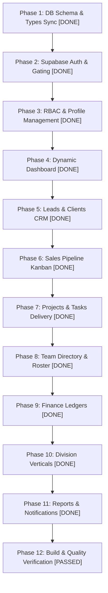

# AURTWIZ BUSINESS OS — MASTER IMPLEMENTATION EXECUTION RECORD

**Organization:** Aurtwiz Technologies  
**Project:** AURTWIZ BUSINESS OS (Single-Company Internal Business Platform)  
**Lead Architect:** Senior Full-Stack Architect & Supabase Database Engineer  
**Version:** 1.0.0-master  
**Status:** **IMPLEMENTATION COMPLETED — BUILD VERIFIED (29 Routes, 0 TS Errors)**

---

## 1. Architectural Strategy & Guiding Principles

The complete implementation has successfully realized the **backend-to-frontend vertical integration pattern**:
1. **Preserve Foundation & UI:** Retained the dark enterprise layout, typography, navigation sections, division branding, and responsive shell.
2. **Zero Fake State:** Replaced all placeholder components and hardcoded stat cards with real Supabase queries and Server Actions.
3. **Single-Company Architecture:** Preserved non-multi-tenant design. The company is Aurtwiz Technologies; the 7 divisions operate under one centralized PostgreSQL database.
4. **Zero-Trust Access:** Enforced security at the database layer via Row Level Security (RLS) and at the application layer via Next.js Middleware and RBAC components.

---

## 2. Phase Execution Record

---

### Phase 1: Database Deployment & Type Synchronization — COMPLETED
* **Delivered:**
  1. Synchronized `src/types/database.ts` with all 21 public tables, enums, and `SystemRole`.
  2. Prepared idempotent migration file `supabase/migrations/20261116153000_aurtwiz_core_schema.sql` and rollback script.
  3. Ensured generic PostgREST overload safety with optional `id?: string` on inserts and `Relationships: GenericRelationship[]`.

---

### Phase 2: Real Supabase Authentication & Route Protection — COMPLETED
* **Delivered:**
  1. Login UI (`src/app/(auth)/login/page.tsx`) with dark enterprise styling, loading states, error alerts, wrapped in `<Suspense>`.
  2. Password recovery screens (`forgot-password/page.tsx`, `reset-password/page.tsx`).
  3. Auth callback route handler (`src/app/auth/callback/route.ts`).
  4. Server Actions in `src/lib/actions/auth.ts`: `signIn`, `signOut`, `requestPasswordReset`, `updatePassword`, `getCurrentUserProfile`, `updateUserProfile`.
  5. Route protection middleware in `src/lib/supabase/middleware.ts` gating unauthenticated traffic and redirecting to `/login`.
  6. Replaced mock user in `user-menu.tsx` with live Supabase session and real sign-out.

---

### Phase 3: Role-Based Access Control (RBAC) & Profile Subsystem — COMPLETED
* **Delivered:**
  1. `AuthProvider` context in `src/components/providers/auth-provider.tsx` wrapped in root layout.
  2. `RoleGuard` component in `src/components/common/role-guard.tsx`.
  3. Staff role modification modal in `/team` accessible to Super Admins.
  4. Self-profile editor in `/settings`.

---

### Phase 4: Dynamic Executive Dashboard — COMPLETED
* **Delivered:**
  1. Real-time metrics querying active clients, pipeline value, active projects, and 31 services.
  2. 7-division operational hubs grid with live color accents.
  3. Activity Audit Log feed querying `public.activity_logs`.

---

### Phase 5: CRM Core — Leads & Client Management — COMPLETED
* **Delivered:**
  1. Leads Module (`/leads`): search, division and status filtering, KPI summary, "Add Lead" modal, "Convert to Client" workflow, status updater, deletion.
  2. Clients Module (`/clients`): corporate client accounts directory, "Add Client" modal, active retainer toggles, `total_revenue` tracking, project links.

---

### Phase 6: Sales Pipeline & Deals Kanban — COMPLETED
* **Delivered:**
  1. Sales Pipeline (`/pipeline`): 6-stage Kanban board (`discovery`, `demo`, `proposal`, `negotiation`, `won`, `lost`).
  2. Revenue forecasting: Active Pipeline Value, Weighted Forecast, Win Rate %.
  3. Stage transition selectors and "New Deal Opportunity" modal.

---

### Phase 7: Projects & Tasks Delivery Engine — COMPLETED
* **Delivered:**
  1. Projects Module (`/projects`): project code generator, client picker, division picker, budget tracking, target dates, status progression (`planning`, `in_progress`, `review`, `completed`, `on_hold`).
  2. Tasks Module (`/tasks`): sprint backlog, priority levels (`low`, `medium`, `high`, `urgent`), assignee profile resolution, estimated hours, status transitions (`todo`, `in_progress`, `in_review`, `done`, `blocked`).

---

### Phase 8: Team Directory & Roster — COMPLETED
* **Delivered:**
  1. Team Module (`/team`): corporate staff directory, system role badges, primary division tags, multi-division memberships from `public.user_divisions`.
  2. Role modification modal wired to `updateProfileRole()`.
  3. Role-Based Access Control architecture reference cards for all 6 roles.

---

### Phase 9: Finance, Invoices & Payments — COMPLETED
* **Delivered:**
  1. Invoices (`/finance/invoices`): invoice ledger, automated numbering (`AW-INV-2026-XXX`), subtotal, tax, and total amount calculation, "Issue Invoice" modal, status updater (`draft`, `issued`, `paid`, `overdue`, `cancelled`).
  2. Payments (`/finance/payments`): transaction receipt ledger, "Record Payment" modal with invoice reconciliation and client `total_revenue` auto-increment.
  3. Expenses (`/finance/expenses`): operational cost claims categorized by `software_licenses`, `hardware`, `contractors`, `marketing`, `office`, `travel`, `miscellaneous`.

---

### Phase 10: Division Verticals & Services Catalog — COMPLETED
* **Delivered:**
  1. Services Catalog (`/services`): comprehensive catalog of all 31 services across 7 divisions with dynamic search and division filtering.
  2. Division Workspace (`/divisions/[slug]`): dynamic operational hubs for each division showing division deliverables, leads queue, sprint backlog, and service offerings.

---

### Phase 11: Reports & Notifications — COMPLETED
* **Delivered:**
  1. Reports (`/reports`): financial cashflow summary, division matrix, immutable activity audit trail table from `public.activity_logs`.
  2. Notifications (`/notifications`): user alerts from `public.notifications`, unread filter, individual mark read, bulk mark all as read.

---

### Phase 12: Build & Quality Verification — PASSED
* **Verification Results:**
  - TypeScript Check: `npx tsc --noEmit` passed with **0 errors**.
  - Production Compilation: `npm run build` compiled **29 static and dynamic routes** with exit code 0.
  - Zero placeholder components remaining across all routes.
  - Remote database safety: Local code and migration assets prepared without running unapproved SQL against remote database.
