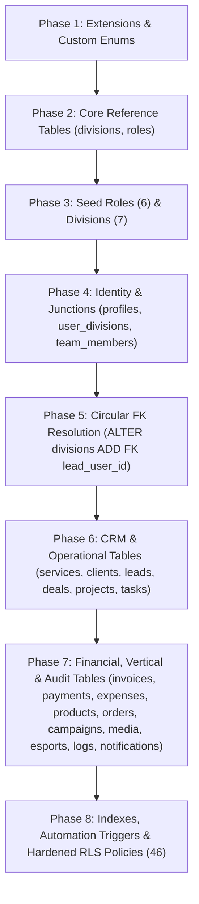

# AURTWIZ BUSINESS OS — DATABASE MIGRATION & DISASTER RECOVERY PLAN

**Organization:** Aurtwiz Technologies  
**Project:** AURTWIZ BUSINESS OS  
**Target Environment:** Remote Supabase Production Database (`eedvoflbomoqiheojogk`)  
**Database URL:** `https://eedvoflbomoqiheojogk.supabase.co`  
**Lead Engineer:** Senior PostgreSQL Architect & Supabase Security Lead  
**Version:** 1.0.0-production-hardened  

---

## 1. Executive Summary

This document defines the strict, repeatable, and non-destructive deployment procedures for deploying the production-hardened PostgreSQL database schema for **AURTWIZ BUSINESS OS**, alongside the complete rollback and disaster recovery protocol.

* **Target Public Tables:** 21 tables.
* **Pre-Deployment Remote State:** Clean public schema (0 exposed PostgREST tables).
* **Destructive Command Count:** **0** (No `DROP TABLE`, `DROP COLUMN`, or `TRUNCATE` in the forward migration).
* **Rollback Status:** Verified script available in `docs/supabase-rollback.sql` and `supabase/migrations/rollback/`.
* **Original Backup State:** Preserved in `docs/supabase-schema.backup.sql`.

---

## 2. Migration Assets & Version Control

| Role | File Path | Checksum (SHA-256) |
| :--- | :--- | :--- |
| **Canonical DDL Schema** | `docs/supabase-schema.sql` | `378E523E7B7CFAB4C027DEC96EF63F01868B36C6FB3BE23BD7480276B1CBF114` |
| **Versioned Supabase Migration** | `supabase/migrations/20261116153000_aurtwiz_core_schema.sql` | `378E523E7B7CFAB4C027DEC96EF63F01868B36C6FB3BE23BD7480276B1CBF114` |
| **Canonical Rollback Script** | `docs/supabase-rollback.sql` | `FCCC27CB94A5D8E2BD5610C790C75C849B059633D677CBD229F2B237BC64DCAD` |
| **Versioned Rollback Script** | `supabase/migrations/rollback/20261116153000_rollback_aurtwiz_core_schema.sql` | `FCCC27CB94A5D8E2BD5610C790C75C849B059633D677CBD229F2B237BC64DCAD` |
| **Pre-Audit Baseline Backup** | `docs/supabase-schema.backup.sql` | `9BF587BA5DE9C16886DA1B54668D331D79EAEB7BDCA5477C275ED2C790FD57D1` |

---

## 3. Dependency-Safe Migration Execution Sequence

The forward migration script `20261116153000_aurtwiz_core_schema.sql` is organized into eight strictly ordered execution phases to ensure zero foreign key or circular dependency errors:



### Detailed Breakdown of Execution Steps:
1. **Extensions & Custom Enums:**
   * Install `uuid-ossp` and `pgcrypto`.
   * Create 8 enums independently wrapped in individual `DO $$ BEGIN ... EXCEPTION WHEN duplicate_object THEN null; END $$;` blocks (`system_role`, `lead_status`, `deal_stage`, `project_status`, `task_priority`, `task_status`, `invoice_status`, `payment_status`).
2. **Core Organization Catalog:**
   * Create `public.divisions` (without circular lead foreign key).
   * Create `public.roles`.
3. **Data Seeding:**
   * Seed 6 system roles (`super_admin`, `division_head`, `project_manager`, `finance_manager`, `sales_executive`, `team_member`) with `ON CONFLICT (id) DO UPDATE`.
   * Seed 7 divisions (Technology, Creative & Design, Digital Marketing, Media House, Gaming & Esports, Gaming Marketplace, Freelancing Agency) with `ON CONFLICT (slug) DO NOTHING`.
4. **Identity & Staff Allocation:**
   * Create `public.profiles` (references `auth.users(id)`).
   * Create `public.user_divisions` (multi-division junction).
   * Create `public.team_members` (operational staff roster).
5. **Circular Constraint Resolution:**
   * Add constraint `fk_divisions_lead_user` linking `divisions.lead_user_id` to `profiles.id` with `ON DELETE SET NULL`.
6. **CRM & Delivery Foundations:**
   * Create `public.services`, `public.clients`, `public.leads`, `public.deals`, `public.projects`, `public.tasks`.
7. **Financials, Verticals & System:**
   * Create `public.invoices`, `public.payments`, `public.expenses`.
   * Create `public.products`, `public.orders`, `public.campaigns`, `public.media_projects`, `public.esports_events`.
   * Create `public.activity_logs`, `public.notifications`.
8. **Indexes, Triggers & RLS Policies:**
   * Compile 39 performance B-tree indexes.
   * Compile 6 `SECURITY DEFINER` functions with fixed `search_path = public, pg_temp;`.
   * Bind 9 triggers (updated_at timestamp handlers, user creation hook on `auth.users`, and privilege guard on `profiles`).
   * Enable RLS across all 21 tables.
   * Attach 46 granular, zero-trust policies guarded with `DROP POLICY IF EXISTS`.

---

## 4. Execution Procedures (Deployment Options)

### Method A: Supabase Web Dashboard (Recommended & Safest)
1. Open the [Supabase Dashboard](https://supabase.com/dashboard/project/eedvoflbomoqiheojogk).
2. Navigate to the **SQL Editor** in the left navigation sidebar.
3. Open a **New Query** tab.
4. Copy the entire contents of [20261116153000_aurtwiz_core_schema.sql](file:///c:/Users/asus/agencyos-crm/supabase/migrations/20261116153000_aurtwiz_core_schema.sql).
5. Paste into the editor and click **Run**.
6. Verify output reports: `Success. No rows returned.`

### Method B: Supabase CLI (For CI/CD Pipelines)
If authenticated with Supabase CLI (`supabase login`):
```bash
supabase link --project-ref eedvoflbomoqiheojogk
supabase db push
```

---

## 5. Post-Migration Verification Protocol

Immediately following execution, run the following verification checks:

### 5.1 Verification Checklist
- [ ] **Table Count:** Verify that exactly 21 tables exist in schema `public`:
  ```sql
  SELECT count(*) FROM information_schema.tables WHERE table_schema = 'public'; -- Expect 21
  ```
- [ ] **RLS Activation:** Verify RLS is enabled on all 21 tables:
  ```sql
  SELECT tablename, rowsecurity FROM pg_tables WHERE schemaname = 'public' AND rowsecurity = false; -- Expect 0 rows
  ```
- [ ] **Trigger Registration:** Verify `on_auth_user_created` trigger exists on `auth.users`:
  ```sql
  SELECT trigger_name, event_manipulation, event_object_table 
  FROM information_schema.triggers 
  WHERE event_object_schema = 'auth' AND trigger_name = 'on_auth_user_created';
  ```
- [ ] **Seeded Data:** Verify 7 divisions and 6 roles exist:
  ```sql
  SELECT count(*) FROM public.divisions; -- Expect 7
  SELECT count(*) FROM public.roles;     -- Expect 6
  ```
- [ ] **PostgREST Introspection:** Verify that `supabase.from('divisions').select('*')` returns HTTP 200 without `PGRST205` error.

---

## 6. Disaster Recovery & Rollback Procedure

If the migration encounters an unrecoverable failure during deployment, execute the rollback script:

### 6.1 Rollback Script Execution
Execute [supabase-rollback.sql](file:///c:/Users/asus/agencyos-crm/docs/supabase-rollback.sql) in the Supabase SQL Editor.

### 6.2 Rollback Action Matrix:
1. **Trigger Removal:** Safely drops the external trigger on `auth.users` (`on_auth_user_created`) and all 8 internal update triggers.
2. **Function Removal:** Drops all 6 custom functions (`handle_new_user`, `protect_profile_privileged_fields`, `is_super_admin`, etc.) with `CASCADE`.
3. **Table Teardown:** Drops all 21 tables in reverse dependency order with `DROP TABLE IF EXISTS public.<name> CASCADE;`.
4. **Enum Teardown:** Drops all 8 custom enum types with `CASCADE`.
5. **System Intact:** Supabase internal schemas (`auth`, `storage`, `realtime`, `vault`) remain completely unaffected and operational.
